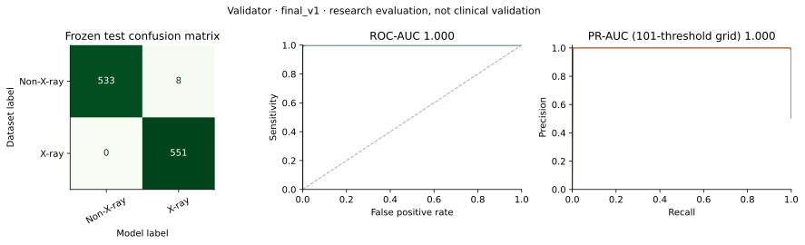
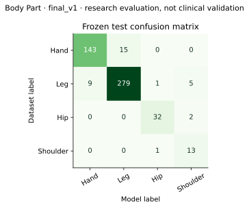
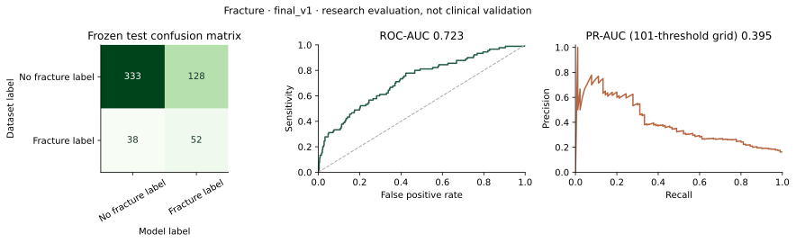

# Final locally trained models

These are real CPU-trained custom PyTorch CNNs, not downloaded diagnostic APIs
or placeholder weights. They are research/educational models with substantial
limitations, especially fracture sensitivity and unsupported-anatomy rejection.
The frozen reports are in `ml/saved_models/final_v1/`. Historical Stage 3/4 results
remain separate and must not be assigned to these new binaries.

## Data, isolation and protocol

The official public sources were checksum-verified by `ml.datasets.download_public`:

| Source | Use | Provenance / terms |
| --- | --- | --- |
| FracAtlas, 4,083 radiographs | All three tasks, real fracture labels | [Official Figshare record](https://figshare.com/articles/dataset/FracAtlas/22363012), CC BY 4.0 |
| CIFAR-10 | Natural non-X-ray negatives | [Official Toronto distribution](https://www.cs.toronto.edu/~kriz/cifar.html), research distribution; cite Krizhevsky 2009 |
| RetinaMNIST | Medical-photo negatives | [Official MedMNIST](https://medmnist.com/), CC BY 4.0 |
| DermaMNIST | 500 official-test OOD examples only | Official MedMNIST, CC BY-NC 4.0; noncommercial evaluation |

No restricted dataset, DUA, login or paid compute was bypassed. The downloader
records official archive checksums; raw files and weights remain ignored locally.
The new final_v1 manifests use seed 42. Before splitting, 3,745 dHash-near pairs
(Hamming distance <=2) were joined into 3,087 duplicate groups. Group-aware
splitting prevents those proxy groups crossing train/validation/test. **True
patient/study isolation is unknown:** FracAtlas does not provide verified patient
IDs. 934 exact/near negative duplicates were removed before training.

| Task | Train | Validation | Frozen test |
| --- | ---: | ---: | ---: |
| Validator | 4,798 | 959 | 1,092 |
| Four-class anatomy | 2,642 | 543 | 500 |
| Fracture | 2,922 | 610 | 551 |

All sources are converted to grayscale. The final input is 1x128x128, centered
aspect-preserving letterboxing, scale [0,1], then mean/std 0.5/0.5. Tiny negative
sources are uniformly upsampled to 224px first to avoid class-specific padding.
Validator training applies the same random 32px-to-128px resolution perturbation
to both labels. Low original resolution and source-frequency shortcuts remain
serious confounders; strong validator numbers do not establish arbitrary-photo
or clinical generalization.

Windows i3-1115G4, 2 cores / 4 logical processors, about 7.8 GiB visible RAM,
Intel UHD, no CUDA. Python 3.12.14, torch 2.14.1+cpu, two CPU threads, batch 16,
seed 42. AdamW(lr=.001, weight_decay=.0001), validation scheduler and patience 3.
Anatomy uses class-weighted cross entropy; binary tasks use train-derived positive
weights in BCEWithLogitsLoss. Validation never receives training augmentation.

The body baseline ran at most 6 epochs. Fracture compared a 4-epoch baseline
with one 6-epoch conservative flip/affine candidate; validation selected the
baseline. Validator ran at most 5 epochs. Checkpoints, experiment selection and
thresholds were frozen using validation before each final test evaluation.
No architecture or threshold was changed after inspecting frozen test results.
An initial 224px body attempt was stopped before any test evaluation for CPU
feasibility. This 128px run is not directly comparable with historical runs.

Metrics below are rounded to four decimals. Binary confusion matrices are
[[TN, FP], [FN, TP]]. ROC-AUC uses average ranks for ties. PR-AUC is trapezoidal
integration on a **101-threshold grid**, not average precision or an exact
all-score-threshold integral. Plots also preserve score-threshold curve points.
Binary metrics use the decision threshold; they are not end-to-end cascade or
patient-facing three-state-policy accuracy. Scores are not calibrated medical
probabilities. Training metadata records the Git HEAD plus a dirty-tree flag;
body/fracture supplemental provenance was added from unchanged artifacts later.

## Validator

Architecture: **XRayValidatorCNN**, 101,553 parameters.
Checkpoint: `ml/saved_models/final_v1/validator/best_validator.pt` (ignored binary).

SHA256: `8cf44462ba45a1d1d6f85a8992baf29d389c5d363d620c0bf7402c9527481d84`.

| Frozen-test metric | Value |
| --- | ---: |
| accuracy | 0.9927 |
| balanced_accuracy | 0.9926 |
| precision | 0.9857 |
| recall_sensitivity | 1.0 |
| specificity | 0.9852 |
| f1 | 0.9928 |
| roc_auc | 1.0 |
| pr_auc | 1.0 |
| true_positives | 551 |
| true_negatives | 533 |
| false_positives | 8 |
| false_negatives | 0 |
| threshold | 0.37 |
| total_samples | 1092 |

Validation-selected decision threshold 0.37; rejection band [0.27, 0.47] (prespecified +/-0.10 margin).

Only scores above 0.47 reach anatomy; scores below 0.27 are non-X-ray, inclusive band is uncertain. Eight binary false positives are not equivalent to eight patient-facing accepted images. OOD DermaMNIST: **500 rejected, 0 accepted, 0 uncertain**. This covers one medical-photo source, not the universe of unsupported images.

Per-source test confusion/metrics are retained in the JSON report (CIFAR-10, RetinaMNIST and individual X-ray regions).

Training wall time: 510.3 s; frozen evaluation time including image loading: 11.23 ms/image. These are local indicative timings, not service latency guarantees.

## Body Part

Architecture: **BodyPartClassifierCNN**, 105,908 parameters.
Checkpoint: `ml/saved_models/final_v1/body_part/best_body_part.pt` (ignored binary).

SHA256: `a6be0c70e9dc972bab2953d9597cc63136444cead2950db78faa6b764ea0d9f1`.

| Frozen-test metric | Value |
| --- | ---: |
| accuracy | 0.934 |
| balanced_accuracy | 0.9309 |
| macro_f1 | 0.8944 |
| weighted_f1 | 0.9349 |
| total_samples | 500 |

Policy: `{"unknown_threshold": 0.6, "selection_split": "validation"}`

Classes: HAND, LEG, HIP, SHOULDER; confidence below 0.60 becomes UNKNOWN.

| Class | Support | Precision | Recall | F1 |
| --- | ---: | ---: | ---: | ---: |
| HAND | 158 | 0.9408 | 0.9051 | 0.9226 |
| LEG | 294 | 0.949 | 0.949 | 0.949 |
| HIP | 34 | 0.9412 | 0.9412 | 0.9412 |
| SHOULDER | 14 | 0.65 | 0.9286 | 0.7647 |

The rejection policy accepts 473/500 (94.6% coverage), with 95.35% accuracy among accepted examples; 27 are rejected. Shoulder precision is only 0.65 with 14 test examples. Four-class confidence is not a reliable mixed/unsupported-image detector: both mixed validation examples in the HTTP run were routed to known classes. Coarse dataset region names do not establish an exact joint or laterality.

Training wall time: 411.2 s; frozen evaluation time including image loading: 10.52 ms/image. These are local indicative timings, not service latency guarantees.

## Fracture

Architecture: **FractureClassifierCNN**, 995,169 parameters.
Checkpoint: `ml/saved_models/final_v1/fracture/best_fracture.pt` (ignored binary).

SHA256: `bb7a8dfad71aa605a25e16cfcc151ea23da612bb385b30f33c3a38885a5e32c3`.

| Frozen-test metric | Value |
| --- | ---: |
| accuracy | 0.6987 |
| balanced_accuracy | 0.6501 |
| precision | 0.2889 |
| recall_sensitivity | 0.5778 |
| specificity | 0.7223 |
| f1 | 0.3852 |
| roc_auc | 0.7228 |
| pr_auc | 0.395 |
| true_positives | 52 |
| true_negatives | 333 |
| false_positives | 128 |
| false_negatives | 38 |
| threshold | 0.51 |
| total_samples | 551 |

Validation-selected decision threshold 0.51; rejection band [0.41, 0.61] (prespecified +/-0.10 margin).

**38 of 90 fracture labels were missed at the binary decision threshold; 128 false positives occurred.** This model is unsuitable for ruling out fracture or clinical screening.

| Region | Test n | Sensitivity | Specificity | Precision | F1 |
| --- | ---: | ---: | ---: | ---: | ---: |
| hand | 158 | 0.56 | 0.797 | 0.3415 | 0.4242 |
| hip | 34 | 0.5714 | 0.5926 | 0.2667 | 0.3636 |
| leg | 294 | 0.625 | 0.7154 | 0.3 | 0.4054 |
| mixed | 51 | 0.4286 | 0.6591 | 0.1667 | 0.24 |
| shoulder | 14 | 0.3333 | 0.5455 | 0.1667 | 0.2222 |

Mixed rows are benchmark/training data only, not an enabled patient routing class. Shoulder has only 3 fracture labels in 14 examples and sensitivity 0.3333. The uncertainty margin suppresses borderline decisions but cannot fix confident errors.

| Candidate | Validation F1 after validation-only threshold selection | Selected |
| --- | ---: | --- |
| baseline | 0.5326 | True |
| conservative_augmentation | 0.4345 | False |

Training wall time: 1644.8 s; frozen evaluation time including image loading: 15.81 ms/image. These are local indicative timings, not service latency guarantees.

## Localization and attention

The experimental single-box regression head was inspected but is not sufficiently
trained/evaluated. No localization metric or exact injury-location claim is
invented; patient-facing bounding boxes remain disabled. Grad-CAM uses the loaded
fracture weights, actual input size and padding-aware transparent overlay, only
for accepted supported suspected-fracture results. It indicates model influence,
not a fracture site, segmentation or clinical localization.

## Reproduction and interpretation

See local-development.md for exact download, preparation and training commands.
Model metadata stores policies, input shape, optimizer/loss, architecture,
checkpoint SHA256, dataset/split version and manifest checksums. Restore the exact
ignored weights to verify these hashes; a retraining on another runtime is not a
promise of byte-identical binaries. Inference refuses missing, corrupt or changed
artifacts. Software tests and illustrative validation uploads are separate from
these frozen model benchmarks. See medical-limitations.md before interpreting
any result. No clinical validation, external cohort or prospective study exists.
